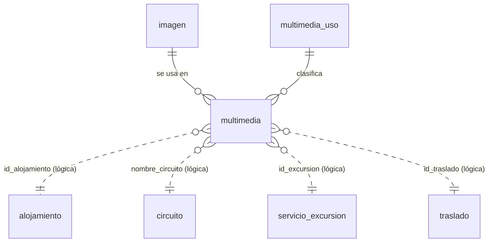

# Esquema de imágenes (multimedia) de EuroVIP

Base: **TropitoursVDT**, esquema `Eurovip`. Contrato: [SPEC-013](specs/SPEC-013-multimedia.md). Migración: `db/tropitoursvdt/migraciones/007_multimedia_imagen.sql` (borrador, 21/10/2026).

## 1. Relación entre tablas



- `imagen` es el **archivo** (dónde está y cómo es).
- `multimedia` dice **qué producto lo usa, para qué y en qué orden**. Un mismo archivo puede usarse en varios productos.
- `multimedia_uso` es el catálogo de usos.
- Hacia los productos **no hay FK** (líneas de puntos): `alojamiento` y `circuito` tienen el idioma en la clave primaria y una FK impediría al backoffice del CMS borrar o renombrar productos. Las fotos de productos que ya no existen no se muestran.

## 2. `Eurovip.imagen`: el archivo

| Columna | Tipo | Nulo | Uso |
|---|---|---|---|
| `id` | int IDENTITY | No | PK |
| `ruta_relativa` | varchar(500) | No | Carpeta dentro de la base de imágenes, termina en `/` (§5) |
| `nombre_archivo` | varchar(255) | No | Nombre único **sin extensión** (§5.3) |
| `extension` | varchar(5) | No | `webp`, `jpg`, `jpeg`, `png` o `avif` |
| `nombre_original` | nvarchar(255) | Sí | Nombre del archivo que se subió |
| `tamano_bytes` | bigint | No | Peso del archivo |
| `ancho` | int | Sí | Píxeles |
| `alto` | int | Sí | Píxeles |
| `creado_utc` | datetime2(3) | No | Fecha de carga en UTC (`DEFAULT SYSUTCDATETIME()`) |

| Restricción | Regla |
|---|---|
| `PK_Eurovip_imagen` | `id` |
| `UQ_Eurovip_imagen_archivo` | No se repite `ruta_relativa` + `nombre_archivo` + `extension` |
| `CK_Eurovip_imagen_ruta` | Solo `a-z`, `0-9`, `-`, `_` y `/`; termina en `/`; no empieza por `/` ni tiene `//` |
| `CK_Eurovip_imagen_nombre` | Solo `a-z`, `0-9`, `-`, `_` (sin puntos: la extensión va aparte) |
| `CK_Eurovip_imagen_extension` | `webp`, `jpg`, `jpeg`, `png`, `avif` (en minúsculas) |
| `CK_Eurovip_imagen_tamano` | `tamano_bytes > 0` |
| `CK_Eurovip_imagen_medidas` | `ancho` y `alto` nulos o mayores que 0 |

Al no admitir `..`, `\`, `:` ni mayúsculas, una ruta no puede salir de la carpeta base y nunca hace falta escapar nada en la URL.

## 3. `Eurovip.multimedia_uso`: catálogo de usos

| Columna | Tipo | Nulo | Uso |
|---|---|---|---|
| `codigo` | varchar(10) | No | PK |
| `descripcion` | nvarchar(100) | No | Texto legible |

| codigo | orden | Se muestra en |
|---|---|---|
| `PORTADA` | 1 | Tarjetas y listados; primera foto del carrusel |
| `INTERMEDIA` | 1 | Cabecera de la ficha del circuito (solo circuitos) |
| `GALERIA` | 1, 2, 3… | Carrusel de la ficha, detrás de la portada |

Un uso nuevo es una fila aquí; si tiene reglas propias (una sola foto, solo un tipo de producto), también hay que cambiar los CHECK de `multimedia`.

## 4. `Eurovip.multimedia`: qué archivo usa cada producto

| Columna | Tipo | Nulo | Uso |
|---|---|---|---|
| `id` | int IDENTITY | No | PK |
| `id_imagen` | int | No | FK → `imagen.id` |
| `tipo` | varchar(15) | No | `ALOJAMIENTO`, `CIRCUITO`, `EXCURSION`, `TRASLADO` |
| `uso` | varchar(10) | No | FK → `multimedia_uso.codigo` |
| `id_alojamiento` | int | Sí | `alojamiento.id_alojamiento` |
| `nombre_circuito` | varchar(50) | Sí | `circuito.nombre_circuito` (es su clave) |
| `id_excursion` | int | Sí | `servicio_excursion.id_Excursion` |
| `id_traslado` | int | Sí | `traslado.id_traslado` |
| `orden` | smallint | No | Posición dentro del uso (`DEFAULT 1`) |
| `texto_alternativo` | nvarchar(250) | Sí | «Piscina principal del hotel» |

| Restricción | Regla |
|---|---|
| `PK_Eurovip_multimedia` | `id` |
| `FK_Eurovip_multimedia_imagen` | `id_imagen` → `imagen.id` |
| `FK_Eurovip_multimedia_uso` | `uso` → `multimedia_uso.codigo` |
| `CK_Eurovip_multimedia_tipo` | `tipo` en la lista |
| `CK_Eurovip_multimedia_referencia` | Solo se llena la referencia del `tipo`; las demás quedan en NULL |
| `CK_Eurovip_multimedia_intermedia` | `INTERMEDIA` solo en `CIRCUITO` |
| `CK_Eurovip_multimedia_unica` | `PORTADA` e `INTERMEDIA` solo con `orden = 1` |
| `CK_Eurovip_multimedia_orden` | `orden > 0` |
| `UQ_Eurovip_multimedia_orden` | Una posición por producto y uso: `(tipo, id_alojamiento, nombre_circuito, id_excursion, id_traslado, uso, orden)`. Con `CK_…_unica`, como mucho una portada y una intermedia por producto |

## 5. Rutas de las imágenes

### 5.1 Estructura

La carpeta `multimedia/` es la **base** y va en la configuración, no en cada fila:

| Configuración | Valor (ejemplo) |
|---|---|
| Carpeta física base | `D:\EuroVIP\Imagenes\multimedia\` |
| `Catalogo:UrlMultimedia` (API) | `https://<servidor-de-imágenes>/multimedia` |

Dentro de la base, una carpeta por tipo de producto y otra por producto (`ruta_relativa`):

| Producto | `tipo` | `ruta_relativa` | Ejemplo |
|---|---|---|---|
| Hotel | `ALOJAMIENTO` | `alojamientos/{id_alojamiento}/` | `alojamientos/322/` |
| Circuito | `CIRCUITO` | `circuitos/{slug del nombre}/` | `circuitos/ruta-colonial/` |
| Excursión | `EXCURSION` | `excursiones/{id_excursion}/` | `excursiones/37/` |
| Traslado | `TRASLADO` | `traslados/{id_traslado}/` | `traslados/5/` |
| Crucero (futuro) | `CRUCERO` | `cruceros/{id_crucero}/` | `cruceros/12/` |

Archivo y URL resultantes:

```
D:\EuroVIP\Imagenes\multimedia\ + alojamientos/322/ + 3f2a9c1e5b7d4e0a9c8b1a2d3e4f5a6b + .webp
https://<servidor>/multimedia/alojamientos/322/3f2a9c1e5b7d4e0a9c8b1a2d3e4f5a6b.webp
```

### 5.2 Cambios respecto a la propuesta inicial

| Propuesta | Queda | Por qué |
|---|---|---|
| `multimedia/…` en cada ruta | `multimedia/` en la carpeta base | Si cambia el servidor o la carpeta, se cambia un valor de configuración y no todas las filas |
| `hotel/` | `alojamientos/` | El mismo nombre que el `tipo` (`ALOJAMIENTO`) y que la tabla `alojamiento` |
| `excusion/` | `excursiones/` | Errata y plural, como el resto |
| `traslado/`, `crucero/` | `traslados/`, `cruceros/` | Todas las carpetas en plural |
| `circuitos/{id_circuito}` | `circuitos/{slug}` | El circuito no tiene id: su clave es `nombre_circuito` («Ruta Colonial»), con espacios y mayúsculas que la ruta no admite. El slug va en minúsculas, sin acentos y con guiones |

### 5.3 Reglas

- **Solo minúsculas, números, `-` y `_`** en carpetas y nombres (lo exige `CK_Eurovip_imagen_ruta`). Slug: «Ruta Colonial» → `ruta-colonial`, «Costa Rica Essencial» → `costa-rica-essencial`.
- **Carpetas y nombres** (pedido de la usuaria, 22/10/2026): dentro de `{Multimedia:CarpetaFisica}` (`C:/inetpub/wwwroot/photosVacacionalparce/eurovip`), una carpeta por tipo y el archivo con el nombre de lo que es, en minúsculas y con guiones (la base solo admite minúsculas; en Windows/IIS `Hotel` y `hotel` son la misma carpeta):
  `destino/`, `pais/`, `traslado/`, `excursion/`, `circuito/`, `circuito_itinerario/`, `slider/`, `crucero/`, `hotel/` (pantalla Hoteles = sección HOTELES BOOKINGMOTOR) y `hoteles/{id_alojamiento}/` (alojamientos). Los **paquetes** (ofertas, «Hoteles exclusivos») son destinos: usan la foto del destino en `destino/`.
  Ejemplos: tarjeta de paquetes Miches → foto del destino `destino/miches.webp`; hotel de la pantalla Hoteles `hotel/hotel-kristal.webp`; circuito `circuito/ruta-colonial.webp` y sus días en `circuito_itinerario/` (columna circuito_itinerario.caratula); de traslados `traslado/traslado-punta-cana.webp`; destino `destino/punta-cana.webp`, banner `destino/punta-cana-banner.webp`, galería `destino/punta-cana-1.webp`, `-2`…; alojamiento `hoteles/1234/riu-palace.webp`; día de circuito `circuito_itinerario/ruta-colonial-dia-3.webp`; crucero `crucero/{título}.webp` y sus partes en `crucero/{título}/actividades|cabinas|itinerario/…`, `crucero/naviera|barco|categoria/{nombre}.webp`.
  Al cambiar una foto se guarda con el MISMO nombre y se reemplaza la anterior (miches.webp, nunca miches-2); solo se numera si ese nombre es la foto de otro producto que se llama igual. La galería se numera -1, -2… El slider sigue con el nombre que se escribe. Herramientas → Fotos → «Poner nombres a las fotos» ordena las que estén de otra forma.
aviera|barco|categoria{nombre}.webp`. Si el nombre ya existe se añade `-1`, `-2`… (nunca se pisa un archivo). El slider sigue con el nombre que se escribe en `slider`. Herramientas → Fotos → «Poner nombres a las fotos» deja así las que tengan otro nombre.
- **Nunca se sobrescribe un archivo.** Para cambiar una foto se sube un archivo nuevo y se cambia la fila de `multimedia`.
- **El uso no va en la ruta** (nada de `…/portada/`): está en `multimedia.uso`. Así, cambiar la portada es cambiar una fila, sin mover archivos.
- **Sin carpeta por idioma**: la foto vale para todos los idiomas.
- **Sin miniaturas en disco**: la web las genera con `next/image`. El servidor de imágenes se añade a `web/src/config/imagenes.ts` para que las optimice.
- **Si se renombra un circuito**, sus archivos se quedan en la carpeta del slug antiguo: la ruta está guardada en cada fila y nada se rompe.
- **Formato recomendado**: `webp`, de 1600 px de ancho como máximo.

### 5.4 Cruceros

La carpeta `cruceros/` queda reservada, pero `multimedia` todavía no admite cruceros: no existe la tabla de cruceros ni su clave. Cuando exista, hará falta una migración que añada la columna `id_crucero`, el tipo `CRUCERO` en `CK_Eurovip_multimedia_tipo`, su caso en `CK_Eurovip_multimedia_referencia` y la columna en `UQ_Eurovip_multimedia_orden`.

## 6. Ejemplo completo

`Eurovip.imagen`

| id | ruta_relativa | nombre_archivo | extension |
|---|---|---|---|
| 1 | circuitos/ruta-colonial/ | a81f2c0d4e5f60718293a4b5c6d7e8f9 | webp |
| 2 | circuitos/ruta-colonial/ | 7c3d9e1f2a3b4c5d6e7f8091a2b3c4d5 | webp |
| 3 | circuitos/ruta-colonial/ | e45b1a2b3c4d5e6f708192a3b4c5d6e7 | jpg |
| 4 | alojamientos/322/ | 9f0aa1b2c3d4e5f60718293a4b5c6d7e | webp |
| 5 | alojamientos/322/ | 1b2c3d4e5f60718293a4b5c6d7e8f901 | webp |

`Eurovip.multimedia` (referencias no usadas en NULL)

| id | id_imagen | tipo | uso | id_alojamiento | nombre_circuito | orden | texto_alternativo |
|---|---|---|---|---|---|---|---|
| 1 | 1 | CIRCUITO | PORTADA | | Ruta Colonial | 1 | Catedral de Santo Domingo |
| 2 | 2 | CIRCUITO | INTERMEDIA | | Ruta Colonial | 1 | Calle de la Zona Colonial |
| 3 | 3 | CIRCUITO | GALERIA | | Ruta Colonial | 1 | Alcázar de Colón |
| 4 | 4 | ALOJAMIENTO | PORTADA | 322 | | 1 | Piscina principal |
| 5 | 5 | ALOJAMIENTO | GALERIA | 322 | | 1 | Habitación doble |

Cómo lo lee el portal:

| Pantalla | Filas |
|---|---|
| Tarjeta del circuito o del hotel | `uso = 'PORTADA'` |
| Cabecera de la ficha del circuito | `uso = 'INTERMEDIA'` (si no hay, la portada) |
| Carrusel de la ficha | `PORTADA` y luego `GALERIA` por `orden` |

Sin filas para un producto, el portal sigue usando su `caratula` (o `imagen` en traslados).

---

## 7. Cómo quedó en el BackOffice de Eurovip (21/10/2026)

Implementado en BackEurovip (FASE 20 de `Database/EUROVIP_BaseDeDatos.sql`). Diferencias con este documento:

| Tema | Queda | Por qué |
|---|---|---|
| Tipos | Además de `ALOJAMIENTO`, `CIRCUITO`, `EXCURSION`, `TRASLADO`: **`DESTINO`** (`id_destino`, carpeta `destinos/{slug}/`), **`PAIS`** (`id_pais`, `paises/{id_pais en minúsculas}/`) y **`HOTEL`** (`id_hotel` = `inicio.id_servicio` de la tarjeta HOTEL de la pantalla Hoteles, `hoteles/{id}/`) | Lo pidió la usuaria: las fotos de destinos, países y hoteles también van aquí. Las tarjetas de la pantalla Hoteles no son filas de `alojamiento` (se identifican por su `id_servicio` en `inicio`). Se amplió como indica §5.4: columna + `CK_…_tipo` + `CK_…_referencia` + `UQ_…_orden` (CAMBIO 64b). |
| Tarjetas de la Home | Tipo **`INICIO`** (`id_inicio` = `inicio.id`, carpeta `inicio/{id}/`): la foto de UNA tarjeta; su URL se copia en `inicio.caratulaDestino` | Pedido de la usuaria (21/10/2026, FASE 22): cada foto es individual; cambiar la de un destino no cambia las tarjetas de excursiones o traslados. Se cambia desde Home de la web (botón cámara en cada tarjeta). Las tarjetas de hoteles y circuitos usan la foto del hotel / circuito. |
| Fuera de multimedia | Fotos del **itinerario de circuito** (`circuito_itinerario.caratula` = URL completa) y del **slider** (`carrusel`, por nombre) | Siguen en sus tablas; solo su archivo va en la carpeta de fotos. |
| Carpeta base | `Multimedia:CarpetaFisica` = `C:\inetpub\wwwroot\photosVacacionalparce\eurovip` y `Multimedia:Url` = `https://fotos.eurovip.com.do/eurovip` (`appsettings.json`) | Pedido de la usuaria (22/10/2026): sitio de fotos fotos.eurovip.com.do. Ahí también van el itinerario de circuito (`circuitos/itinerario/{slug}/`) y el slider (`slider/`, `slider/md/`, `slider/sm/`), aunque no estén en estas tablas. |
| Formato | Siempre `webp`, 1600 px de lado como máximo, calidad 82 (se convierte al subir) | §5.3 |
| Columnas de antes | Al cambiar la **portada** se copia su URL en `destino.caratula` (ya **no** en las tarjetas de `inicio`: cada tarjeta tiene su foto, tipo `INICIO`), `alojamiento.caratula` y `circuito.caratula`; `traslado.imagen` se vacía | Para que la Home, los flyers y lo que lee esas columnas siga igual. |
| Lectura | Vista `Eurovip.vMultimedia` (`clave` y `ruta` ya armadas). `spPortalListarExcursiones`, `spPortalObtenerExcursion` (+ galería), `spPortalBuscarTraslados` y `spPortalListarTraslados` devuelven `imagen_ruta` | La URL completa es `Catalogo:UrlMultimedia` + `/` + `ruta`. |
| Fotos de antes | Herramientas → Fotos (multimedia) → «Pasar las fotos de antes» (Superadministrador) | Copia las portadas que estaban en `wwwroot/imagenes` a multimedia; no borra nada y se puede repetir. |

Pantallas: Home de la web (foto de cada tarjeta; en circuitos también las del itinerario), Excursiones, Traslados, Circuitos y Cruceros
(botón **Fotos** en cada tarjeta de la lista: se guardan al momento, componente `wwwroot/js/eurovip-fotos.js`), Excursiones, Traslados (portada + galería), Circuitos (portada + intermedia + galería), Hoteles (foto por número de hotel),
Herramientas → Destinos / Alojamientos (portada + galería) y Países (portada + galería). Componente: `wwwroot/js/eurovip-multimedia.js`,
controlador `/Multimedia` (permiso según el módulo del producto).

> **Pendiente del portal:** `Eurovip.spPortalListarPublico` y `Eurovip.spPortalObtenerCircuito` (borradores del 15/10) leen
> `multimedia.url`, `multimedia.nombre` y `multimedia.portada`, columnas que no existen en este esquema: hay que adaptarlos a
> `vMultimedia` (`ruta`, `uso`, `orden`).
